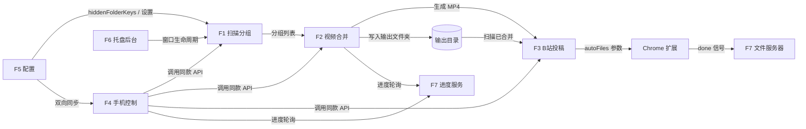

# 视频合并工具 · 功能规格文档（功能合并版）

> **文档类型**：合并版功能规格文档（Functional Specification）
> **目标版本**：v1.0（MVP 已完成）+ v1.1（加固改造已落地）
> **编写依据**：`src/**` 全量源码（主进程 / preload / 渲染进程 / 手机控制服务器 / Chrome 扩展 / 单元测试）、`README.md`、`产品需求文档.md`、`deliverables/software-company/*`（增量 PRD / 增量设计 / 架构评审 / QA 验证）
> **编写日期**：2026-07-27
> **目标读者**：开发者、维护者、产品、测试

---

## 0. 文档说明与"功能合并"范围

### 0.1 目的
本文件将散落在 `README.md`、`产品需求文档.md`、增量设计文档以及**真实源码**中的全部功能，进行**去重、合并与分组优化**，形成一份覆盖软件所有现有功能的单一权威规格。它替代上述文档中相互重复或已过时的功能描述，作为后续开发、测试与维护的基准。

### 0.2 合并方法
- **去重**：将 README"核心功能 / 特色功能"、PRD"功能清单"与代码实现逐条比对，剔除仅存在于文案但代码未实现的条目，以及重复描述。
- **合并分组**：按"数据流 + 职责"将 13 项离散能力聚为 **7 大功能域**（见第 1、3 章）。
- **差异标注**：凡文案与代码不一致之处，以"⚠️ 差异"标注（汇总于第 7 章），避免误导。

### 0.3 已知基线事实（以源码为准）
| 项 | 真实情况 |
|----|---------|
| 技术栈 | Electron 33 + React 18 + TypeScript 5 + Vite/electron-vite + Ant Design 5 + Zustand（声明但未实际使用，见第 7 章）+ FFmpeg 内嵌（`@ffmpeg-installer/ffmpeg` + `fluent-ffmpeg`）|
| 支持输入格式 | `.flv`、`.m4s`、`.blv`（**不含 `.ts`**——代码显式排除，因大航海直播的 TS 合并会报错）|
| 输出格式 | 合并产物统一为 `.mp4`（stream copy，不重新编码）|
| 平台 | 主目标 Windows 10/11；macOS/Linux 可自构建 |
| 进程模型 | 主进程（业务/IPC/FFmpeg spawn）+ preload（contextBridge）+ 渲染进程（React UI）；外加一个**独立手机控制 HTTP 服务器**与一个**本地文件服务器** |

---

## 1. 功能总览

下表为合并后的 **7 大功能域**，覆盖软件全部现有功能，无遗漏。

| # | 功能域 | 一句话说明 | 主要入口 | 优先级 |
|---|--------|-----------|-----------|--------|
| F1 | 输入目录与扫描分组 | 选择目录→递归扫描→按"日期+标题+时间间隔"智能分组→过滤录制中与已合并 | 桌面"浏览/扫描"按钮、手机"扫描" | 高 |
| F2 | 视频合并与转换 | 单组/批量并行合并为 MP4（stream copy）；含格式转换与信息探测能力 | 桌面"一键合并"、手机"合并/批量合并/合并投稿" | 高 |
| F3 | B站投稿与发布 | 扫描已合并文件→唤起 B站投稿页→Chrome 扩展自动填表/截帧封面/投稿 | 桌面"投稿"弹窗、手机"投稿"Tab | 高 |
| F4 | 手机远程控制面板 | 同 WiFi 下手机浏览器远程查看分组、合并、投稿、改设置、上传手机视频 | 设置面板"手机控制"开关、手机浏览器访问 `http://<IP>:9820` | 中 |
| F5 | 配置与个性化 | 配置持久化（原子写/监听同步）、设置面板、浅/深色主题 | 设置抽屉、主题按钮 | 中 |
| F6 | 系统托盘与后台运行 | 关闭窗口最小化到托盘、双击恢复、原生深色标题栏 | 后台运行开关、窗口关闭拦截 | 中 |
| F7 | 跨端同步与本地文件服务 | 桌面↔手机 配置/排除列表双向同步；本地文件服务器给 Chrome 扩展供文件；统一进度轮询 | 内部机制（无直接 UI） | 中 |

> 说明：原 README 中"不压缩模式""批量并行合并""排除/恢复分组""自动打开输出文件夹""手机端控制面板""B站投稿助手"等条目，均已并入上述 7 域，不再单列。

---

## 2. 系统总体架构与功能关联

### 2.1 架构分层
```
┌──────────────────────────────────────────────────────────────┐
│  渲染进程 (React + AntD)  —— Home / Settings / UploadModal │
│       │  window.api (contextBridge)                         │
│       ▼                                                        │
│  preload (invokeApi 统一错误包装)                            │
│       │  IPC invoke                                           │
│       ▼                                                        │
│  主进程 (Electron Main)                                        │
│   ├─ 扫描分组 (performScan)      ├─ 合并引擎 (ffmpeg.ts)  │
│   ├─ 配置服务 (load/saveConfig) ├─ 文件服务器 (127.0.0.1)│
│   ├─ 控制服务器 (HTTP :9820)    └─ 系统托盘 / 生命周期   │
│       │                  │                  │                      │
│       ▼                  ▼                  ▼                      │
│  手机浏览器(移动Web UI)   Chrome扩展(B站投稿助手)   FFmpeg 子进程   │
└──────────────────────────────────────────────────────────────┘
```

### 2.2 关键接口清单
| 类别 | 标识 | 说明 |
|------|------|------|
| IPC（渲染↔主） | `config:load/save`、`dialog:selectFolder/selectOutputFolder/openDirectory/openExternal`、`scan:flvFiles`、`video:getInfo/merge/convert/batchMerge`、`progress:get/getBatch`、`fileServer:register/checkDone`、`control:getUrl/getIP/toggle`、`network:getInfo`、`mergedFiles:get/upload`、`window:minimizeToTray/restoreFromTray/forceQuit`、`theme:set`、`browser:getForegroundWindow/minimize` | 统一返回 `{success, data?, message?}`；`preload` 的 `invokeApi` 在 `success=false` 时抛错 |
| HTTP REST（手机控制） | `/api/login`、`/api/status`、`/api/groups`、`/api/scan`、`/api/merge`、`/api/merge/batch`、`/api/upload`、`/api/upload/reset`、`/api/merged-files`、`/api/config`、`/api/groups/exclude\|restore\|excluded`、`/api/video-stream`、`/api/upload/video` | 默认端口 `9820`，监听 `0.0.0.0`；密码为空则免登录，否则需 `X-Token` 头或 query `token` |
| Chrome 扩展 ↔ App | `member.bilibili.com` 投稿页注入；`?autoFiles=<本地文件URL>` 参数唤起并自动投稿；完成后 `GET ?signal=done` 回写完成信号 | 扩展从本地文件服务器下载视频后自动上传并提交 |

### 2.3 功能关联图


---

## 3. 功能模块详细说明

> 每个模块均按 **目标 / 输入 / 处理逻辑 / 输出 / 入口 / 关联 / 异常边界** 描述。

### 3.1 F1 — 输入目录与扫描分组

| 项 | 内容 |
|----|------|
| **目标** | 自动发现分散的直播分段文件，并按"同一场直播"归组，供后续一键合并 |
| **输入** | 主输入目录 `inputFolder`、可选额外目录 `inputFolder2`、合并间隔阈值 `maxIntervalHours`（默认 2.5 小时）|
| **处理逻辑** | ① 递归遍历目录（异步 `fs.promises.readdir`，不阻塞主进程）；② 仅接受 `.flv/.m4s/.blv`；③ 解析文件名：`YYYY-MM-DD HH-MM-SS-mmm <标题>`，并剥离 `_PART\d+` 后缀使 PART 分段与非 PART 归同组；④ 按"**标题相同 且 与上一段时间间隔 ≤ 阈值**"归入同一组，否则新开组（支持回溯已有组补入）；⑤ **过滤正在录制中**（组内任一文件含 `_PART` 即整组隐藏）；⑥ **过滤已合并**（输出目录存在 `日期_标题` 或 `标题_日期` 匹配的 MP4 即视为已完成）；⑦ 双目录时合并两路扫描结果（同 key 合并文件数/大小）；⑧ 结果缓存 10s TTL，避免排除/恢复时重复遍历 |
| **输出** | `ScanResult { rootPath, folders: FolderGroup[] }`，每组含 `key、folderName、fileCount、totalSize、files[]、date、title` |
| **入口** | 桌面"扫描视频"按钮、启动自动扫描、手机 `/api/scan` |
| **关联** | → F2（提供待合并分组）；← F5（排除列表 `hiddenFolderKeys` 过滤）；↔ F4（手机复用同一扫描逻辑，保证列表一致）|
| **异常边界** | 无法访问的文件/目录静默跳过；未设输入目录返回明确错误；扫描并发互斥（手机端 `isScanning` 守卫）|

### 3.2 F2 — 视频合并与转换

本域包含**合并引擎**与**上层调用（单组/批量/转换/探测）**。

#### 3.2.1 合并引擎（核心，`ffmpeg.ts`）
| 项 | 内容 |
|----|------|
| **处理逻辑** | ① 先 `openSync` 探测每个源文件是否可读取，**录制中(被锁)的文件自动跳过**并给出 warning；② 用 FFmpeg `concat` demuxer + `-c copy`（stream copy，**不重新编码**，保留原画质、极快）；③ **真实时长进度**：合并前用 `ffmpegProbe` 探测各文件 `duration` 并求和得 `totalDuration`，再按 FFmpeg `-progress` 输出的 `out_time_ms` 换算百分比（无时长信息时回退到 0→99.9 平滑占位）；④ **磁盘空间预检**：需 `总大小 × 1.1` 可用空间，不足直接报错；⑤ **内存守卫**：批量任务启动前若可用内存 < 500MB 则等待或跳过；⑥ **互斥锁**：`isMerging` 标志阻止桌面端与手机端同时合并；⑦ **30 分钟超时**：超时杀掉 FFmpeg 子进程并清理临时文件；⑧ **安全落盘**：先写 `tmpdir()` 临时 MP4，成功后再 `rename`（跨盘回退 `copy+unlink`），覆盖已有文件时先备份 `_backup.mp4`；⑨ 输出文件 `size>0` 才视为成功 |
| **输出路径命名** | 桌面端：`标题_日期.mp4`；手机/旧逻辑：`日期_标题_<时间戳>_合并版.mp4` |

#### 3.2.2 单组 / 批量并行合并
| 项 | 内容 |
|----|------|
| **单组合并** | `video:merge`：一次合并一个分组 |
| **批量并行合并** | `video:batchMerge`：多分组并发，**并发数上限 4**（设置可填更大但被钳制）；批量前**预探测**所有任务首文件时长并并行求和，避免各任务重复探测；每任务独立进度（`-1` 表示失败），聚合为总进度；内存不足时跳过剩余任务 |
| **输入** | 分组文件路径数组 + 输出路径（+ 并发数）|
| **输出** | 每个分组一个 MP4；批量返回 `BatchMergeResult[]`（成功/失败/warning）|
| **入口** | 桌面"一键合并选中视频"、手机 `/api/merge`、`/api/merge/batch` |

#### 3.2.3 格式转换（能力存在，UI 未接 ⚠️差异）
| 项 | 内容 |
|----|------|
| **说明** | `convertToMp4`（`video:convert` IPC）已实现：单文件 FLV→MP4 **重新编码**（`libx264` + `aac` + `-movflags +faststart`），带进度与 30 分钟超时。但**桌面端与手机端均无调用入口**（增量 PRD 将"格式转换接 UI"列为非目标 I3）。属"已实现能力、未暴露" |
| **视频信息探测** | `getVideoInfo`（`video:getInfo`）：返回 `duration / codec / width / height`，供引擎预估进度与 UI 展示 |

### 3.3 F3 — B站投稿与发布

| 项 | 内容 |
|----|------|
| **目标** | 将合并好的 MP4 快速投递到哔哩哔哩，减少人工填表 |
| **输入** | 输出目录（扫描其中 MP4 作为"待投稿"）；用户选中的已合并文件 |
| **处理逻辑** | ① 扫描输出目录得到 `MergedFile[]`（按文件名解析直播时间戳倒序）；② 将选中文件**注册到本地文件服务器**，拿到 `http://127.0.0.1:<port>/?fileId=...&name=...`；③ 打开 B站投稿页 `member.bilibili.com/platform/upload/video/frame` 并附加 `?autoFiles=<URLs>`；④ **插件联动**（开关 `pluginLinkage`）：仅当开启时才注册并传 URL，并轮询等待 Chrome 扩展回写 `done` 信号；⑤ 完成后按开关**自动最小化浏览器** / **自动关闭 App**（`autoCloseApp`）|
| **输出** | 在用户浏览器中打开的 B站投稿页（由扩展接管自动投稿）|
| **入口** | 桌面"投稿"弹窗、合并完成后"自动打开 B站投稿页"、手机 `/api/upload` |
| **关联** | → F7（文件服务器供扩展下载）；← F5（联动/自动关闭等开关）|

#### Chrome 扩展"投稿助手"（F3 的子能力）
注入 `member.bilibili.com` 投稿页，识别 `autoFiles` 参数后：① 从本地文件服务器**下载**视频为 `File`；② **批量上传**（首个走主文件输入，其后走"添加分P"）；③ 自动设置**创作声明=内容无需标注**、**可见范围**（面板可选 公开/仅自己可见）；④ **封面**：从视频第 2 秒截帧，4:3 居中裁剪为 JPG 上传；⑤ 点击"立即投稿"；⑥ 完成后 `GET ?signal=done` 通知 App 自动关闭。

### 3.4 F4 — 手机远程控制面板

| 项 | 内容 |
|----|------|
| **目标** | 同一局域网内，用手机浏览器远程控制电脑上的合并任务 |
| **输入** | 手机浏览器访问 `http://<电脑IP>:9820`；控制密码（可选）|
| **处理逻辑** | ① 内置 HTTP 服务器（默认 9820，监听 `0.0.0.0`）；② **登录**：密码为空则免登录，否则需 POST `/api/login` 拿 token，并带**暴力破解限频**（同 IP 60s 内失败 5 次锁定）；③ 提供完整 REST API（见 2.2）；④ 内置移动端 Web UI（登录 / 分组 / 已排除 / 投稿 / 设置 / 手机视频 共 5 个 Tab）；⑤ **视频流预览**：`/api/video-stream` 支持 HTTP Range 分段播放；⑥ **手机视频上传**：`/api/upload/video` 接收手机选中的视频文件写入输出目录（扩展名白名单校验）|
| **输出** | 与桌面端一致的分组/合并结果、投稿状态、配置变更 |
| **入口** | 设置面板"手机控制面板"开关 + 端口；手机浏览器 |
| **关联** | 复用 F1/F2/F3 的同款后端逻辑；↔ F5（配置/排除列表双向同步）；→ F7（视频流走文件服务器）|

### 3.5 F5 — 配置与个性化

| 项 | 内容 |
|----|------|
| **配置持久化** | 写入 `userData/config.json`（开发期用项目内 `user-data`）；**原子写**（先写 `.tmp` 再 `rename`，防中断损坏）；主进程启动时**监听配置文件变更**（防抖 500ms），手机端改配置即时同步到桌面端 |
| **配置项** | `inputFolder / inputFolder2 / outputFolder / outputFileName / darkMode / concurrency / maxIntervalHours / autoOpenWebsite / autoOpenFolder / autoCloseBrowser / autoCloseApp / runInBackground / controlEnabled / controlPort / controlPassword / hiddenFolderKeys` |
| **设置面板**（桌面抽屉） | 同场直播判定间隔、并行合并数、额外扫描目录、自动打开输出文件夹/投稿页、B站插件联动、打开 B站后最小化浏览器、投稿完成关闭 App、后台运行、手机控制开关/端口/密码；并显示**局域网访问地址** |
| **主题** | 浅色/深色切换；同时驱动 Ant Design `ConfigProvider` 算法与原生窗口标题栏 `nativeTheme`（深色模式时标题栏变暗）|
| **入口** | 设置抽屉、标题栏主题按钮、手机"设置"Tab |

### 3.6 F6 — 系统托盘与后台运行

| 项 | 内容 |
|----|------|
| **托盘图标** | 代码以 32×32 像素**程序生成**（蓝色圆形 + 白色播放三角），无需外部图标资源 |
| **后台运行** | 开启 `runInBackground` 后，点击窗口关闭**不退出**而是隐藏到托盘；双击托盘图标或"显示窗口"恢复；"退出"菜单项 `forceQuit` 真正退出 |
| **原生主题** | 深色模式通过 `nativeTheme.themeSource` 影响系统标题栏颜色 |
| **入口** | 后台运行开关、窗口关闭事件、托盘菜单 |

### 3.7 F7 — 跨端同步与本地文件服务

| 项 | 内容 |
|----|------|
| **配置/排除双向同步** | 桌面排除分组 → 写 `hiddenFolderKeys` 并通知手机端；手机排除/恢复 → 回调主进程 `saveConfig` 并反向通知渲染进程刷新；两端扫描结果始终一致 |
| **本地文件服务器** | 给 Chrome 扩展提供合并后视频：`fileId = sha256(filePath)[:16]`，`fileId→path` 映射；**15 分钟**投稿完成超时自动重置 `done` 信号；**30 分钟**未访问的注册项自动清理；支持 Range 下载 |
| **统一进度服务** | 合并进度存于主进程（`mergeProgress` / `batchMergeProgress`），渲染端与手机端均通过**轮询**获取（手机端按状态智能节流：空闲 3s / 合并 1s / 投稿 2s）|
| **入口** | 内部机制，无独立 UI |

---

## 4. 功能关联关系

| 源模块 | 依赖/关联 | 说明 |
|--------|-----------|------|
| F1 扫描分组 | → F2、← F5、↔ F4 | 为合并提供分组；受排除列表过滤；手机复用同逻辑 |
| F2 视频合并 | → F3、→ F7、↔ F4 | 产出 MP4 供投稿；进度经 F7 暴露；手机可触发 |
| F3 投稿 | → F7、← F5 | 依赖文件服务器供扩展；受联动/自动关闭开关控制 |
| F4 手机控制 | 复用 F1/F2/F3、↔ F5 | 远端等价于桌面操作；与桌面共享配置/排除 |
| F5 配置 | 影响 F1/F3/F4/F6 | 中心化的设置源 |
| F6 托盘后台 | 影响 F1/F4 生命周期 | 后台运行时窗口隐藏但仍可控 |
| F7 同步/文件服务 | 支撑 F3/F4 | 文件服务器是投稿链路与手机视频预览的基石 |

**无循环依赖**：F7 为基础服务层，向上被 F3/F4 消费；F5 为配置中枢，被其余域读取；F1→F2→F3 为主数据流，F4 为旁路等价入口。

---

## 5. 用户操作流程

### 5.1 桌面端主流程
```mermaid
flowchart TD
    S[启动] --> L[加载配置+自动扫描]
    L --> CH{有输入目录?}
    CH -- 否 --> B[点"浏览"选输入目录]
    CH -- 是 --> SC[显示待合并分组]
    B --> SC
    SC --> SE{需调间隔/并发?}
    SE -- 是 --> ST[设置抽屉调整] --> SC
    SE -- 否 --> MK{选分组}
    MK --> MG[点"一键合并选中视频"]
    MG --> PR[并行合并+进度条]
    PR --> AU{开启自动打开投稿页?}
    AU -- 是 --> OP[打开B站投稿页+插件联动]
    AU -- 否 --> END[完成]
    OP --> EXT[Chrome扩展自动投稿]
    EXT --> DC{自动关闭App?}
    DC -- 是 --> Q[退出] 
    DC -- 否 --> END
```

### 5.2 手机端流程
打开 `http://<IP>:9820` → 登录（如有密码）→ 点"扫描" → 勾选分组 → "批量合并" 或 "合并投稿" → 在"投稿"Tab 勾选已合并文件 → "投稿选中文件" → 自动打开 B站并由扩展接管；亦可在"手机视频"Tab 上传本地视频到电脑。

### 5.3 一键合并→投稿自动链路
桌面选分组 → 合并 →（若 `autoOpenWebsite`）打开 B站投稿页并带 `autoFiles` → Chrome 扩展下载视频、批量上传、自动填声明/封面/可见范围、点投稿 → 回写 `done` →（若 `autoCloseApp`）App 自动退出。

---

## 6. 非功能性需求

### 6.1 性能
| 维度 | 指标 / 机制 |
|------|---------------|
| 扫描 | 异步递归，不阻塞主进程；结果缓存 10s，排除/恢复操作不重复全盘遍历 |
| 合并速度 | stream copy 不重新编码，速度接近文件拷贝；PRD 目标：合并 10 段 ≤ 30s（不含转码）|
| 进度准确性 | 基于**真实探测时长求和**，百分比平滑可信（非 0→100 跳变）；无时长信息时回退平滑占位 |
| 并发 | 批量并行，并发上限 **4**；批量前并行预探测时长 |
| 内存 | 启动新合并任务前检测可用内存，< 500MB 时等待或跳过，防 OOM |
| 磁盘 | 合并前预检需 `总大小 × 1.1` 可用空间，不足提前报错 |
| 超时 | 单合并任务 30 分钟上限，超时杀进程并清理临时文件 |
| 投稿完成信号 | 15 分钟超时自动重置，防状态卡死 |

### 6.2 兼容性
| 维度 | 要求 |
|------|------|
| 操作系统 | Windows 10/11 主目标；macOS/Linux 可自构建（代码含 Windows 专属 `powershell` 前台窗口探测，非 Win 平台安全降级）|
| 输入格式 | `.flv`、`.m4s`、`.blv`（**不含 `.ts`**）|
| 输出格式 | `.mp4`（H.264+AAC 常见编码，stream copy 直通）|
| 文件名 | 支持中文、空格、特殊字符（路径统一用 `path` 处理，列表文件单引号转义）|
| FFmpeg | 内嵌打包（`app.asar.unpacked`），用户无需单独安装 |

### 6.3 安全（加固 v1.1 已落地）
- 渲染进程 `sandbox: true`；FFmpeg 在主进程 spawn，不受沙箱影响。
- 生产包设置 Content-Security-Policy（dev 跳过以保留 Vite HMR）。
- IPC 入参（路径等）做非空 / 绝对路径 / 存在性 / 越界（敏感系统目录）校验。
- 手机控制端：密码登录 + 同 IP 60s 内失败 5 次限频；token 用 `X-Token` 头或 query 传递。
- 文件上传扩展名白名单（仅视频类）。

### 6.4 可靠性
- 配置**原子写**（`.tmp`+`rename`），防写入中断损坏。
- 合并**互斥锁**防止桌面端与手机端同时写。
- 录制中（文件被锁）片段**自动跳过**并提示；输出先写临时文件再安全移动，覆盖时备份。
- 输出文件 `size>0` 才判成功；失败有友好中文错误（权限/文件缺失/格式不兼容/内存不足等）。

### 6.5 可用性
- 核心任务 3 步内完成（选目录→扫描→合并）。
- 浅/深色主题；系统托盘后台运行；移动端 Web 自适应（Tab + 底部操作栏 + 断线提示）。

### 6.6 可维护性
- TypeScript `strict` 开启；`any` 与魔法值收敛（常量/类型单一来源，见增量设计 `src/shared` 规划）。
- 单元测试通过 `vitest` 真实引用源码（文件名解析、分组、FFmpeg 解析、配置、合并锁等）。

---

## 7. 合并过程中发现的差异与待办

| # | 差异 / 缺口 | 影响 | 建议 |
|---|-----------|------|------|
| D1 | **README 声称支持 M4S/TS/BLV，代码实际仅 `.flv/.m4s/.blv` 且显式排除 `.ts`** | 用户按 README 放 TS 文件会被忽略 | 以代码为准修正 README；或在 UI 提示不支持 TS |
| D2 | **格式转换 `convertToMp4` 已实现但 UI 无入口** | 能力闲置，PRD 列为非目标 I3 | 若需暴露，补桌面"转换"按钮；否则在文档标注为内部能力 |
| D3 | **PRD 强调"FLV 专用"，代码已支持 `.m4s/.blv`** | 文案滞后于实现 | 更新 PRD 输入格式描述 |
| D4 | **`package.json` 声明 `zustand` 但源码从未 import** | 冗余依赖 | 按增量 C4 清理 |
| D5 | 双目录扫描（`inputFolder2`）、插件联动、手机视频上传为代码已落地但原 PRD 未覆盖的功能 | 规格不全 | 本文档已补入 F1/F3/F4 |
| D6 | 输出文件名存在两套格式（桌面 `标题_日期` vs 手机/旧 `日期_标题_..._合并版`）| 同一直播在不同端命名不一致 | 统一命名规则，便于"已合并"过滤匹配 |

---

## 8. 术语表

| 术语 | 含义 |
|------|------|
| FLV / M4S / BLV | 直播录制常见分段封装格式；本工具输入格式 |
| Stream Copy | FFmpeg `-c copy`，直接拷贝音视频流不重新编码，速度快、保画质 |
| PART 文件 | 录制软件对"正在录制"分段加的 `_PARTxxx` 后缀，工具据此判定该场直播未结束 |
| 同场直播分组 | 按"标题相同 + 时间间隔 ≤ 阈值"归为一组的分段集合 |
| 控制服务器 | 主进程内嵌的 HTTP 服务（:9820），供手机远程控制 |
| 文件服务器 | 主进程内嵌 HTTP 服务，向 Chrome 扩展提供合并后视频下载 |
| 插件联动 | 合并后把视频 URL 传给 B站投稿 Chrome 扩展，由其自动完成投稿 |
| `hiddenFolderKeys` | 被用户排除、不在主列表显示的分组 key 集合，持久化于配置 |

---

**文档版本**：v1.0（功能合并版）
**状态**：基于源码与既有文档整合，可作为功能基准；差异项见第 7 章。
